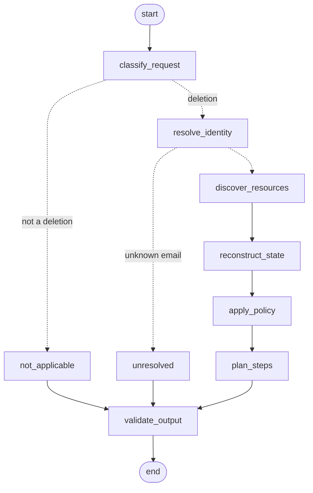

# Ghost Data Still Exists — Deletion-Audit Agent

This agent audits personal-data deletion requests for the HackerRank Orchestrate (October 2026) challenge. For every request in `dataset/deletion_requests.csv` it:

1. decides whether the person actually asked for deletion (an LLM call, cached);
2. resolves the person's current and historical identifiers;
3. finds every record, data flow and backup that belongs to them;
4. reconstructs each record's state at the case's `audit_at`, separately for every copy (primary, read replica, failover replica, ...);
5. applies `deletion_rules.csv` to decide what must be deleted, redacted, anonymized, retained or blocked;
6. writes the ordered `FINDING` → `REMEDIATION` → `VERIFICATION` steps to `output.csv` (repo root).

Only step 1, plus a one-time reading of PDF and screenshot evidence, uses a language model. Everything else is deterministic Python over a SQLite database built from `dataset/`.

---

## 1. Requirements

| Requirement | Version | Notes |
| --- | --- | --- |
| Python | 3.12 | `uv` downloads it automatically if missing |
| [uv](https://docs.astral.sh/uv/) | 0.5 or newer | installs and pins all Python dependencies |
| An LLM API key | — | Anthropic by default; not needed if the caches in `code/.cache/` already exist (see §6) |
| The challenge dataset | — | the `dataset/` folder at the repository root, unchanged |

Install `uv` if you do not have it:

```bash
# macOS / Linux
curl -LsSf https://astral.sh/uv/install.sh | sh

# Windows (PowerShell)
powershell -ExecutionPolicy ByPass -c "irm https://astral.sh/uv/install.ps1 | iex"
```

## 2. Setup

Run every command from the **repository root** (the folder that contains `dataset/` and `code/`).

**Step 1: install dependencies.** This creates `code/.venv` from the pinned `code/uv.lock`:

```bash
uv sync --project code
```

**Step 2: configure the model.** Create a file named `.env` in the repository root:

```dotenv
MODEL=anthropic:claude-sonnet-5-5
ANTHROPIC_API_KEY=your-key-here
```

- `MODEL` uses LangChain's `provider:model` form. The code never hard-codes a vendor.
- `.env` is git-ignored. Never commit it or put it in `code.zip`.
- To use another provider, add its LangChain package and set its key. For example, `uv add --project code langchain-openai`, then `MODEL=openai:<model-name>` and `OPENAI_API_KEY=...`. Validate a new provider with the `sample` command before trusting it.

**Step 3 (optional): check the setup.** This should print the command list:

```bash
uv run --project code python code/main.py --help
```

## 3. Running

| Command | What it does | Writes |
| --- | --- | --- |
| `uv run --project code python code/main.py sample` | Audits the 32 sample requests, then scores them against `dataset/sample_output.csv` | `output_sample.csv` (repo root) |
| `uv run --project code python code/main.py run` | Audits the 518 evaluation requests (the submission) | `output.csv` (repo root) |
| `uv run --project code python code/main.py score` | Re-scores an existing `output_sample.csv` (repo root) without re-running | — |
| `uv run --project code python code/main.py evaluate` | Runs `sample` and its scoring, then the hand-built audit and classifier cases in `code/evaluation/custom_cases.py` | `output_sample.csv` |
| `uv run --project code python code/main.py ingest` | Only rebuilds the audit database (useful when debugging loaders) | `code/.cache/audit.db` |

`run` also writes `code/evaluation/usage_report.md`, which covers the model calls made during that run.

Both CSV files have the header `case_id,deletion_status,steps_json`, with rows sorted by case number (`case_2` before `case_10`).

Add `--no-llm` to `sample`, `run`, `evaluate` or `ingest` to forbid model calls. The run then uses only cached results and stops with a clear error if a needed result is missing from the cache.

Every `run` and `sample` starts from scratch. It rebuilds the database from `dataset/`, so a stale database can never leak into an answer.

### What a run prints

```text
1/4 ingesting dataset/ into the audit database ...
2/4 classifying all 550 requests (398 distinct texts) ...
    10 non-deletion requests; privacy-intake log disagrees on 0
3/4 correlating workflows and auditing 518 eval cases ...
4/4 writing .../output.csv ...
wrote 518 rows to .../output.csv
statuses: COMPLETE=155, INCOMPLETE=353, NOT_APPLICABLE=10
model calls this run: 35; elapsed 193.2s; per-case traces in .../code/.cache/traces/eval.jsonl
usage report written to .../code/evaluation/usage_report.md
```

The first run on a fresh checkout makes 20 classification calls and 15 document-extraction calls: about 3 minutes and USD 0.54 with Claude Sonnet 5.5. Every later run makes no model calls and finishes in a few seconds. A cold run and a cached run produce byte-identical `output.csv` files.

The "privacy-intake log" line compares the model's decisions with the activity log's own `CLASSIFY_REQUEST` rows. Those rows are claims, so they never change an answer. Any disagreement is printed as a warning for a human to review.

`sample` then prints the score block (see §7) and writes per-case differences to `code/.cache/sample_diff.txt`.

### Debugging a single case

Every run writes one JSON line per case to `code/.cache/traces/<split>.jsonl`. Each line holds:

- the classified intent;
- the resolved subject and its evidence window;
- every linked resource with its category, rule, verdict, and the exact evidence sighting (evidence id, copy, state, time, identifiers still exposed);
- any contract problems.

```bash
grep '"case_24"' code/.cache/traces/sample.jsonl | python -m json.tool
```

## 4. How it works

```text
dataset/ ──► ingest ──► SQLite (code/.cache/audit.db)
                            │
                            ├─► classify all requests (LLM, batched, cached)
                            ├─► correlate anonymous deletion-workflow activity across all cases
                            │
                            └─► per case: LangGraph workflow ──► output.csv
```

### 4.1 Ingestion (`audit/ingest/`)

Every evidence file is read once and normalized into one table of **observations**. An observation is one sighting of one resource, with:

- when the fact held (`observed_at`) and when the file was captured (`captured_at`);
- the owning system and the physical copy (`primary`, `read_replica`, `failover_replica`, ...);
- a state (`PRESENT`, `ABSENT`, `REDACTED`, `ANONYMIZED`, `ACTIVE`, `DISABLED` or `BLOCKED`, or none for a pure claim);
- the identifiers it shows.

| Format | Loader | Notes |
| --- | --- | --- |
| CSV tables | `tables.py` | loaded verbatim |
| Identities + audit log | `identities.py` | every current and historical email, phone, hash and user_id, with validity windows; hashes derived for old emails |
| SQL snapshots | `sql_snapshots.py` | executed into in-memory SQLite and introspected; primary and replica tables become separate copies; each listed table is also recorded as **coverage** (missing rows imply absence) |
| JSON | `json_records.py` | snapshot bundles, service exports, lookup ledgers |
| Logs | `logs.py` | 6 line formats; lookups are joined across lines by `trace_id`, so an outcome line knows which identifier was searched |
| Text handover | `text_records.py` | pipe-delimited check lines |
| PDF / PNG | `documents.py` + `extraction.py` | one cached structured-output LLM call per file; identifiers from PDFs are verified literally against the PDF text layer, so a hallucinated value can never link evidence to a person |
| Activity log | `activity.py` | operation results are **claims** (no state); only status-check templates ("remains enabled", "can still be restored", "repopulated") carry a state |

### 4.2 Request classification (`audit/intent.py`, `prompts/request_classification.md`)

The model reads each request in its original language and returns:

- `intent`: one of `DELETION`, `ACCESS`, `PORTABILITY_EXPORT`, `CORRECTION`, `MARKETING_OPT_OUT` or `OTHER`;
- `authorizes_deletion`;
- a one-sentence rationale.

Requests to *verify or finish* an earlier deletion count as deletion. Requests that say to keep the account do not.

Distinct texts are sent 20 per call. Each answer is cached under a key built from the text, the prompt and the model, so editing the prompt or switching the model re-classifies automatically.

### 4.3 Cross-case workflow correlation (`audit/correlation.py`)

A deleted profile or an anonymized analytics record no longer carries any identifier. Its only trace is an anonymous `deletion_worker` row in the global activity log. These rows are attributed to cases by elimination across all 550 requests at once. A resource is assigned to a case only when exactly one candidate is left after these constraints:

- each row type runs in a characteristic window relative to the case's `reported_at`;
- a resource linked by identifier to anyone is left to identifier linking;
- the profile row's result must agree with the case's `reported_status`;
- each case takes at most one resource per type;
- rows of one workflow run keep a fixed cadence: measured from the run's primary-profile row, each later row falls on one of a few second-of-minute offsets.

The cadence offsets are not hard-coded. Each run first learns them from cases whose rows are already attributed with certainty, by identifier or by elimination, then uses them only to rule candidates out.

Ambiguous rows stay unassigned rather than being guessed.

### 4.4 The per-case graph (`audit/graph.py`)



| Node | Module | Decision |
| --- | --- | --- |
| `classify_request` | `intent.py` | reads the cached intent; non-deletion → `NOT_APPLICABLE`, `[]` |
| `resolve_identity` | `identity.py` | email (current or historical) → `user_id` → every identifier. If the same person filed an earlier request, evidence up to that request's `audit_at` belongs to the earlier episode and is excluded |
| `discover_resources` | `discovery.py` | resources whose observations carry one of the subject's identifiers (observed by `audit_at`), plus resources attributed by workflow correlation |
| `reconstruct_state` | `reconstruct.py` | for each resource and copy, the latest sighting at `audit_at` (see 4.5) |
| `apply_policy` | `policy.py` | data category → rule → verdict `COMPLIANT`, `VIOLATION` or `UNKNOWN`; any violation makes the case `INCOMPLETE` |
| `plan_steps` | `steps.py` | builds and orders the steps |
| `validate_output` | `steps.py` | checks the output contract (numbering, phase and operation order, allowed operation/state pairs, evidence rules) |

### 4.5 State at `audit_at`

- **Claims vs evidence.** Workflow statuses and activity results never prove a state. Only evidence does: snapshot rows, lookup results, status checks and documents.
- **Cut-off.** Only evidence captured at or before `audit_at` can be cited.
- **Copies.** The primary view and each replica are judged separately, so a stale replica row stays a finding even after the primary was deleted.
- **Listings vs explicit sightings.** A resource missing from a snapshot listing is absent only by inference. Within a copy, an explicit sighting made during the request's lifetime outranks a listing absence. A listing absence replaces an explicit sighting only when that sighting predates the request.
- **Exposure.** For each present sighting the agent records which of the subject's identifiers are still visible: direct fields, matched identifiers, `IDENTIFIABLE` results and PII-scan matches.

### 4.6 Policy (`audit/policy.py`)

The data category comes from the evidence's `record_type` when a source states one. Otherwise it is inferred from the resource-id prefix and the record's own fields:

- `file_name`/`uploaded_by` → support attachment;
- `message_text`, or a document describing a ticket or conversation → support message.

If nothing in the record decides it, the agent falls back on the operation the deletion workflow attempted on the record (redact vs delete), which shows how the platform itself classified it.

A catalog entry (`LINK_RESOURCE_IDENTITY`) proves that a record existed, and nothing more. It is used as evidence only when no other source shows the record's state.

| Category | Rule | Compliant when |
| --- | --- | --- |
| USER_PROFILE, SEARCH_INDEX_ENTRY, CACHE_ENTRY, USER_EXPORT, MARKETING_PROFILE, SUPPORT_ATTACHMENT, SECONDARY_IDENTIFIER | DELETE | every copy is absent |
| SUPPORT_MESSAGE, EMAIL_DELIVERY_LOG | REDACT | present with no direct identifiers (the customer `user_id` reference may stay) |
| ACCOUNT_TOMBSTONE | REDACT | only the stable `user_id` remains |
| ANALYTICS_PROFILE, PRODUCT_TELEMETRY | ANONYMIZE | present with nothing linking it to the person, not even `user_id` |
| SECURITY_AUDIT_LOG, LEGAL_HOLD_RECORD | RETAIN (while the stated retention or hold is active) | present |
| BACKUP_ARCHIVE | RETAIN, restore blocked | restore is blocked |
| Data flows | disable (recreation risk) | disabled |

### 4.7 Steps (`audit/steps.py`)

| Verdict | Steps produced |
| --- | --- |
| Violation | a finding citing the violating sighting, a remediation step, and a verification step |
| Compliant resource in a `COMPLETE` case | a verification step citing the proving evidence |
| Compliant resource in an `INCOMPLETE` case | a verification step with an empty `evidence_id`, because the check runs after remediation |
| `UNKNOWN` resource | appears only as a post-remediation check in `INCOMPLETE` cases |

Steps are sorted by phase, then by the operation order in the problem statement, then by `system_id` and `resource_id`. That order puts `DISABLE_DATA_FLOW` and `BLOCK_RESTORE` ahead of record changes. Output JSON uses sorted keys and compact separators so reruns are byte-identical. The grader ignores key order and whitespace.

## 5. Project layout

```text
code/
├── main.py                      CLI: run | sample | score | ingest
├── pyproject.toml, uv.lock      pinned dependencies (uv)
├── prompts/
│   ├── request_classification.md   intent prompt
│   └── document_extraction.md      PDF/PNG extraction prompt
├── audit/
│   ├── paths.py                 repo-relative locations (works from any cwd, any OS)
│   ├── db.py                    SQLite schema
│   ├── normalize.py             identifier canonical forms (email, phone, hash, name)
│   ├── systems.py               resource-id prefix → owning system_id
│   ├── llm.py                   provider-agnostic chat model + token-usage log
│   ├── extraction.py            cached PDF/PNG structured extraction
│   ├── intent.py                cached, batched request classification
│   ├── identity.py              subject resolution and evidence window
│   ├── discovery.py             identifier-based resource linking
│   ├── correlation.py           cross-case workflow attribution
│   ├── reconstruct.py           per-copy state at audit_at
│   ├── policy.py                categories, rules, verdicts
│   ├── steps.py                 step planning, ordering, validation, serialization
│   ├── graph.py                 LangGraph per-case workflow
│   ├── pipeline.py              end-to-end run and CSV writer
│   ├── scoring.py               sample scoring
│   ├── usage.py                 writes evaluation/usage_report.md from the run's model calls
│   └── ingest/                  one loader per evidence format
└── evaluation/
    ├── custom_cases.py          8 hand-built audit cases + 6 classifier cases
    ├── evaluation_report.md     accuracy, custom cases, failures and improvements
    └── usage_report.md          generated by `run`: calls, tokens, cost
```

## 6. Caches, determinism and secrets

Everything generated lives in `code/.cache/`, which is git-ignored:

| File | Contents | Safe to delete? |
| --- | --- | --- |
| `audit.db` | the SQLite database built from `dataset/` | yes, rebuilt every run |
| `extractions/<file_id>.json` | one structured extraction per PDF/PNG, keyed by file hash + prompt hash + model | yes, but rebuilding costs ~15 model calls |
| `request_intents.json` | request classifications, keyed by text + prompt + model | yes, but rebuilding costs ~20 model calls |
| `llm_usage.jsonl` | one line per model call: model, purpose, input/output tokens, latency | yes; it is the source for `evaluation/usage_report.md` |
| `traces/*.jsonl`, `sample_diff.txt` | per-case reasoning traces and sample differences | yes |

- With the caches in place, a run is fully deterministic: same inputs, same bytes in `output.csv` (repo root).
- Without them, the only nondeterminism is in model answers, and every model answer is validated against a schema and, for PDFs, against the source text.
- API keys are read only from the environment or `.env` and are never written to caches, logs or traces.

## 7. Current results on the 32 sample requests

`uv run --project code python code/main.py evaluate`:

| Metric | Value |
| --- | --- |
| Status accuracy | 1.000 (32/32) |
| Step precision | 1.000 |
| Step recall | 0.974 |
| Step F1 | 0.987 |
| Field accuracy (`system_id` / `state` / `evidence_id`) | 0.974 each |
| Field accuracy (`step_no`) | 0.922 |
| Exact full-sequence match | 0.844 (27/32) |
| Mean sequence similarity (LCS) | 0.963 |
| Resource recall | 0.955 |
| Custom audit cases | 8/8 |
| Custom classifier cases | 6/6 |

Metric definitions are in the docstring of `audit/scoring.py`. The full write-up, including the improvement history, is in `code/evaluation/evaluation_report.md`.

**Known gaps.** All 5 missed sample steps are for resources the agent did not find:

- three expected resources (`account_004`, `audit_record_6645`, `audit_record_5569`) appear nowhere in `dataset/` except the answer key;
- the other two are anonymous deletion-worker rows that more than one case could still own after elimination. Correlation deliberately leaves those unassigned rather than guessing.

## 8. Troubleshooting

| Symptom | Fix |
| --- | --- |
| `error: MODEL is not set` | create `.env` in the repository root as in §2 |
| `... have no cached classification and --no-llm was given` | run once without `--no-llm`, or restore `code/.cache/request_intents.json` |
| `warning: no extraction for evidence_..` | the PDF/PNG cache is missing; run once without `--no-llm` |
| authentication or 401 errors | check the API key variable for your provider in `.env` |
| `ModuleNotFoundError` | run through `uv run --project code ...` (or activate `code/.venv`) |

## 9. Packaging for submission

From the repository root, package the code without the dataset, virtual environment or caches:

```bash
zip -r code.zip README.md code -x "*/__pycache__/*" "*/.venv/*" "code/.cache/*" "*/.DS_Store"
```

`code/.cache/` holds a database rebuilt from `dataset/`, so it stays out of the archive. A grader running the code needs an API key, or the two cache files described in §6.
